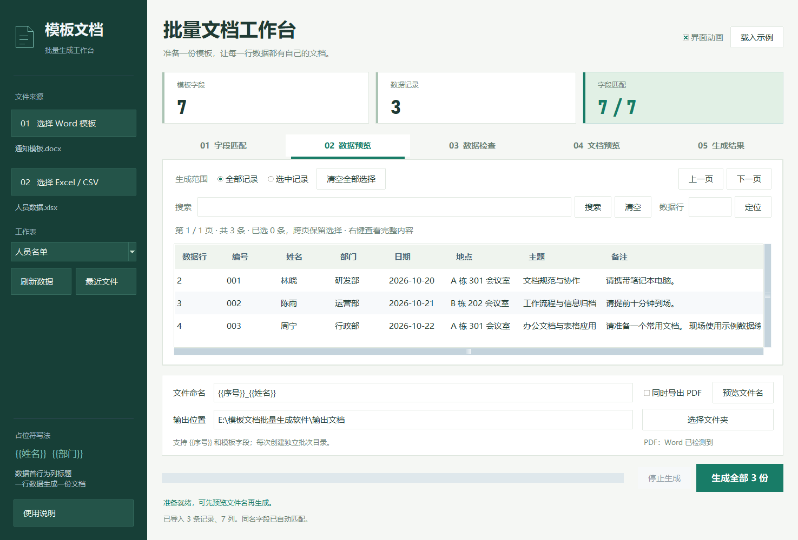

# 模板文档批量生成软件 v1.15

将 Word 模板与 Excel / CSV 名单结合，按每条记录生成独立文档，适合批量制作通知、证明等。

支持字段匹配、必填检查、数据搜索与选择、文档预览、批量生成、失败重试、历史批次续作和结果 ZIP 导出。v1.15 增加逐条进度保存与意外退出恢复，以及可停止的后台搜索。模板和业务数据在本机处理。



## 先区分源码和成品

- **本仓库只有源码，不附带 EXE。** GitHub 的 **Code → Download ZIP** 下载的是源码，需要按下文安装环境才能运行。
- **已拿到完整运行目录**：直接双击 `模板文档批量生成.exe`，无需安装 Python；移动时保留整个目录，包括 `_internal`。
- 要让没有 Python 的人使用，可自行打包；若希望别人从 GitHub 下载现成程序，还需另行上传完整便携 ZIP 到 Release。

## 环境准备与下载

本文使用 **Windows 10 / 11、64 位 Python 3.13 和 PowerShell**。当前打包流程使用 Python 3.13，其他版本及系统未按此流程验证。

1. 从 [Python 官网](https://www.python.org/downloads/windows/)选择 Python 3.13 的 **Windows installer (64-bit)**，安装时保留 pip、Python Launcher，可勾选 `Add python.exe to PATH`。
2. 安装后重新打开 PowerShell，运行 `py -3.13 --version`，应显示 `Python 3.13.x`。
3. 从[项目页面](https://github.com/sugar-219/template-document-generator)点击 **Code → Download ZIP**，完整解压。
4. 打开包含 `README.md`、`requirements.txt`、`src` 的那层文件夹，右键选择“在终端中打开”，使用 PowerShell。

**下面的命令都在项目根目录执行，每一步成功后再继续。** 首次安装依赖需要联网，软件日常处理文件无需联网。

## 从源码运行

依次执行：

```powershell
py -3.13 -m venv .venv
.\.venv\Scripts\python.exe -m pip install -r requirements.txt
.\.venv\Scripts\python.exe src/app.py
```

第一条创建独立环境，第二条安装运行依赖，第三条打开软件窗口。**不需要激活环境。** 运行期间终端被占用是正常的，关闭软件后才返回命令提示符。

以后启动只需执行第三条命令，不必反复创建环境和安装依赖。若整体移动项目，建议重新创建 `.venv`。

## 第一次使用

1. 点击右上角 **“载入示例”**，载入通知模板和 3 条人员数据。
2. 核对“字段匹配”，点击 **“检查数据”**，确认无错误。
3. 选择输出位置；小窗口先打开右上角 **“导出设置”**。第一次不必开启 PDF。
4. 点击 **“生成全部 3 份”**，在结果目录检查 3 份 DOCX 和 `生成清单.csv`。

换成自己的文件时，模板使用 `.docx`，要替换的位置写成 `{{姓名}}` 等；数据使用 `.xlsx` / `.csv`，第一行是列标题，后续每行一条记录。导入后核对字段匹配、必填项和生成范围。

**搜索只筛选显示，不会自动改变生成范围。** 只生成部分记录时，需选择记录并切换为“选中记录”。

## 打包成 EXE 和分享 ZIP

先完成源码运行并关闭软件窗口，再依次执行：

```powershell
.\.venv\Scripts\python.exe -m pip install -r requirements-dev.txt
powershell -NoProfile -ExecutionPolicy Bypass -File .\tools\build.ps1 -PythonExe .\.venv\Scripts\python.exe
.\.venv\Scripts\python.exe tools/package_release.py
```

成功后，项目根目录会生成：

- `桌面版/模板文档批量生成.exe`：双击运行，需保留整个 `桌面版` 文件夹。
- `模板文档批量生成软件_v1.15.zip`：完整便携包，适合发给别人；接收者完整解压后打开 EXE。
- `.build/archive-test.json`：便携包文件数量和哈希校验结果。

构建成功时终端显示“已生成桌面版”，ZIP 脚本成功时输出文件数量及 SHA-256。生成后请再用示例验证一次。构建失败时先处理错误，不要把原有旧 EXE 当作本次成功产物。

**不要单独发送 EXE。** 运行依赖在 `_internal`，示例和第三方许可也应一并保留。本地生成 ZIP 不会自动上传 GitHub。

## PDF、恢复与限制

- **PDF 和真实页面预览**需要安装 Microsoft Word 或 LibreOffice，安装后重启软件；仅有 WPS 不启用转换。普通 DOCX 生成不需要 Office。
- **修改源数据后**先保存，再刷新或“重新读取来源”；Excel 公式应提前计算并保存，软件不负责重算。
- **意外退出后**在“生成结果”选择“载入历史批次”，只恢复进度完整且文件通过校验的记录；未确认的文件不自动算成功。
- **换电脑续作**要复制整个批次目录，包括隐藏的 `.任务状态`；“打包本批次”只分享结果，不包含续作所需快照。
- 不支持 `.doc`、`.xls`、`.docm`、加密文件、图片占位符、条件模板和循环表格。字体、长文本和最终分页仍需核对。

简要操作见[快速开始](快速开始.md)，完整规则、恢复限制和本地设置说明见[使用说明](使用说明.md)。

## 开发验证

回归测试结束应显示 `OK`：

```powershell
.\.venv\Scripts\python.exe -m unittest discover -s tests -v
```

界面验证需要可用的 Windows 桌面会话，使用独立测试设置和示例：

```powershell
New-Item -ItemType Directory -Path .build -Force | Out-Null
.\.venv\Scripts\python.exe src/app.py --smoke-test (Join-Path $PWD '.build/smoke.json') --smoke-delivery --smoke-files --smoke-report --smoke-search
(Get-Content .build/smoke.json -Raw | ConvertFrom-Json).status
```

最后预期输出 `PASS`。已安装 Word / LibreOffice 时，可在启动验证命令末尾加 `--smoke-pdf --smoke-preview`，检查真实转换及页面预览。

## 常见问题

| 问题 | 处理方法 |
| --- | --- |
| `py` 找不到或没有 Python 3.13 | 检查 Python 安装并重新打开终端。若 `python --version` 确认是 3.13，可用 `python -m venv .venv` 创建环境，后续仍使用 `.venv` 中的 Python。 |
| 找不到依赖文件或 `src/app.py` | 回到包含 README、src 和 requirements.txt 的项目根目录。 |
| 依赖下载失败 / 提示缺模块 | 检查网络，重新执行安装命令；安装和启动都使用同一个 `.venv` 解释器。 |
| PowerShell 禁止执行 Activate.ps1 | 本文无需激活环境；直接使用上述命令即可。 |
| 下载源码后找不到 EXE | 源码仓库没有 EXE，先从源码运行，或按上文自行打包。 |
| EXE 报缺 DLL | 完整解压并保留 `_internal`，不要从 ZIP 内直接启动或只复制 EXE。 |
| PDF 不可用 | 安装 Word / LibreOffice，处理首次启动或激活提示，再重启软件。 |

## 项目结构

| 路径 | 用途 |
| --- | --- |
| `src/`、`assets/` | 运行源码和图标资源。 |
| `示例文件/` | Word 模板及 XLSX / CSV 演示数据。 |
| `tools/`、`tests/` | 构建、许可收集、验证工具和回归测试。 |
| `requirements.txt`、`requirements-dev.txt` | 运行依赖、含打包工具的开发依赖。 |
| `.venv/`、`.build/` | 本地环境、构建缓存和测试输出，已忽略。 |
| `桌面版/`、版本 ZIP | 本机构建的运行目录与便携包，已忽略。 |

软著材料和个人业务文件不包含在本源码仓库中；当前程序不提供在线更新或数字签名。
